<div align="center">

# Profile README Gallery

The six complete reference profiles are displayed below. Scroll to compare their original layouts and components.

</div>

---

## gargibhardwaj24

<div align="center">

<!-- PORTRAIT - generated by scripts/dotify.py from assets/jacket.png.
     Colour mode, so one file serves both GitHub themes. Regenerate with:
       python scripts/dotify.py assets/jacket.png -o assets/portrait \
         --cols 100 --equalize --detail 0.5 --color -->

<br>

<!-- NAME / TAGLINE - animated typing -->
<a href="https://github.com/gargibhardwaj24">
  
</a>

<br>

<!-- SOCIALS -->
<a href="https://linkedin.com/in/gargibhardwaj24"></a>
<a href="mailto:gargibhardwaj2430@gmail.com"></a>
<a href="https://dossier-iota-one.vercel.app"></a>
<a href="https://codeforces.com/profile/gargibhardwaj24"></a>
<a href="https://leetcode.com/u/gargibhardwaj24"></a>


</div>

---

## `~/` whoami

```console
$ cat about.txt
```

Hi, I'm **Gargi Bhardwaj**. I build things that sit somewhere between machine learning and the web,
and I solve problems for fun when neither of those is cooperating.

- Currently building **[Sage](https://github.com/gargibhardwaj24/Sage)** and **[Spyder](https://github.com/gargibhardwaj24/spyder_frontend)**
- Portfolio: **[dossier-iota-one.vercel.app](https://dossier-iota-one.vercel.app)**
- Learning **React + Machine Learning**
- Fun fact: **I started coding seriously because I wanted to build things I wished existed.**

<br>

<div align="center">

## `~/` toolbox


</div>

---

<div align="center">

## `~/` skill radar

<table>
<tr>
<td width="50%" align="center" valign="middle">

<!-- Self-rated radar - edit assets/skills.json, the workflow redraws it -->
<picture>
  <source media="(prefers-color-scheme: dark)"  srcset="assets/radar-dark.svg">
  <source media="(prefers-color-scheme: light)" srcset="assets/radar-light.svg">
  
</picture>

</td>
<td width="50%" align="center" valign="middle">

<!-- Live radar built from real language byte counts across your repos -->
<picture>
  <source media="(prefers-color-scheme: dark)"  srcset="assets/radar-langs-dark.svg">
  <source media="(prefers-color-scheme: light)" srcset="assets/radar-langs-light.svg">
  
</picture>

</td>
</tr>
</table>

</div>

---

<div align="center">

## `~/` contribution calendar

<!-- 3D isometric calendar, regenerated every 6h by .github/workflows/metrics.yml -->

<br><br>

<!-- Snake eats the contribution graph - .github/workflows/snake.yml -->
<picture>
  <source media="(prefers-color-scheme: dark)"  srcset="https://raw.githubusercontent.com/gargibhardwaj24/gargibhardwaj24/output/snake-dark.svg">
  <source media="(prefers-color-scheme: light)" srcset="https://raw.githubusercontent.com/gargibhardwaj24/gargibhardwaj24/output/snake.svg">
  
</picture>

</div>

---

<div align="center">

## `~/` the numbers

<!-- Generated by scripts/cards.py into this repo. Deliberately NOT
     github-readme-stats / streak-stats / github-profile-trophy: those are
     shared public instances that go down and take the whole section with them. -->
<picture>
  <source media="(prefers-color-scheme: dark)"  srcset="assets/card-stats-dark.svg">
  <source media="(prefers-color-scheme: light)" srcset="assets/card-stats-light.svg">
  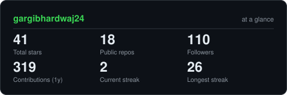
</picture>

<br>


<br><br>


</div>

---

<div align="center">

## `~/` selected work

<!-- Cards generated by scripts/cards.py from assets/projects.json.
     Stars, forks and language are pulled live from the API on every run. -->
<table>
<tr>
<td width="50%">
  <a href="https://github.com/gargibhardwaj24/dossier">
    <picture>
      <source media="(prefers-color-scheme: dark)"  srcset="assets/card-dossier-dark.svg">
      <source media="(prefers-color-scheme: light)" srcset="assets/card-dossier-light.svg">
      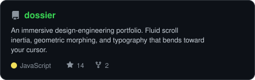
    </picture>
  </a>
</td>
<td width="50%">
  <a href="https://github.com/gargibhardwaj24/Sage">
    <picture>
      <source media="(prefers-color-scheme: dark)"  srcset="assets/card-Sage-dark.svg">
      <source media="(prefers-color-scheme: light)" srcset="assets/card-Sage-light.svg">
      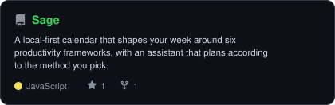
    </picture>
  </a>
</td>
</tr>
<tr>
<td width="50%">
  <a href="https://github.com/gargibhardwaj24/Socrates">
    <picture>
      <source media="(prefers-color-scheme: dark)"  srcset="assets/card-Socrates-dark.svg">
      <source media="(prefers-color-scheme: light)" srcset="assets/card-Socrates-light.svg">
      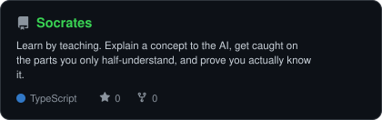
    </picture>
  </a>
</td>
<td width="50%">
  <a href="https://github.com/gargibhardwaj24/humanOS">
    <picture>
      <source media="(prefers-color-scheme: dark)"  srcset="assets/card-humanOS-dark.svg">
      <source media="(prefers-color-scheme: light)" srcset="assets/card-humanOS-light.svg">
      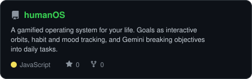
    </picture>
  </a>
</td>
</tr>
</table>

<sub>

| project | live | stack |
|---|---|---|
| **[dossier](https://github.com/gargibhardwaj24/dossier)** | [dossier-iota-one.vercel.app](https://dossier-iota-one.vercel.app) | `JavaScript` `GSAP` `Lenis` |
| **[Sage](https://github.com/gargibhardwaj24/Sage)** | [sage-calendar.vercel.app](https://sage-calendar.vercel.app) | `JavaScript` |
| **[Socrates](https://github.com/gargibhardwaj24/Socrates)** | [socrates-one-coral.vercel.app](https://socrates-one-coral.vercel.app) | `Next.js` `Prisma` `TypeScript` |
| **[humanOS](https://github.com/gargibhardwaj24/humanOS)** | [human-os-two.vercel.app](https://human-os-two.vercel.app) | `JavaScript` `Gemini` |

</sub>

</div>

---

<div align="center">

<sub>`01110100 01101000 01100001 01101110 01101011 01110011 00100000 01100110 01101111 01110010 00100000 01110011 01100011 01110010 01101111 01101100 01101100 01101001 01101110 01100111`</sub>

</div>


---

## arifhaxn

<!-- ===== THEME-AWARE HERO BANNER ===== -->
<!-- GitHub automatically shows dark.svg in dark mode and light.svg in light mode -->

<picture>
  <source media="(prefers-color-scheme: dark)" srcset="https://raw.githubusercontent.com/arifhaxn/arifhaxn/main/dark.svg">
  <source media="(prefers-color-scheme: light)" srcset="https://raw.githubusercontent.com/arifhaxn/arifhaxn/main/light.svg">
  
</picture>

<!-- ===== GITHUB STATS ===== -->

<div align="center">

<!-- Streak — full width -->
<picture>
  <source media="(prefers-color-scheme: dark)" srcset="https://streak-stats.demolab.com/?user=arifhaxn&hide_border=true&background=0A101F&stroke=22D3EE&ring=A78BFA&fire=10B981&currStreakLabel=22D3EE&sideLabels=94A3B8&currStreakNum=F8FAFC&sideNums=F8FAFC&dates=64748B&titleColor=22D3EE&card_width=1180" />
  
</picture>

<br/>

<!-- Stats + Top languages — side by side -->
<picture>
  <source media="(prefers-color-scheme: dark)" srcset="https://github-readme-stats-sigma-rosy-28.vercel.app/api?username=arifhaxn&show_icons=true&count_private=true&include_all_commits=true&hide_rank=true&hide_border=true&title_color=22D3EE&icon_color=A78BFA&text_color=94A3B8&bg_color=0A101F&card_width=500" />
  
</picture>
<picture>
  <source media="(prefers-color-scheme: dark)" srcset="https://github-readme-stats-sigma-rosy-28.vercel.app/api/top-langs/?username=arifhaxn&layout=compact&langs_count=8&hide_border=true&title_color=22D3EE&text_color=94A3B8&bg_color=0A101F&card_width=500" />
  
</picture>

</div>

<!-- ===== CONTRIBUTION SNAKE ===== -->

<div align="center">

<picture>
  <source media="(prefers-color-scheme: dark)" srcset="https://raw.githubusercontent.com/arifhaxn/arifhaxn/output/snake-dark.svg" />
  <source media="(prefers-color-scheme: light)" srcset="https://raw.githubusercontent.com/arifhaxn/arifhaxn/output/snake-light.svg" />
  
</picture>

</div>

<!-- ===== END SNAKE ===== -->
<br/>
<br/>
<div align="center">

</div>

<!-- ===== SOCIAL BADGES ===== -->
<br/>
<div align="center">

<a href="https://www.linkedin.com/in/arif-hasan-672249358/">
  
</a>
&nbsp;&nbsp;
<a href="https://www.instagram.com/arifhaxn/">
  
</a>
&nbsp;&nbsp;
<a href="https://www.facebook.com/arifhaxnn">
  
</a>
&nbsp;&nbsp;
<a href="mailto:arifhasan.connect@gmail.com">
  
</a>
&nbsp;&nbsp;
</div>

<!-- ===== END SOCIAL BADGES ===== -->

<!-- =================================== -->


---

## emmi-lili

<div align="center">

<!-- BANNER - terminal profile.sh --live (additive). Generated by scripts/banner/generate.py.
     ~0.7–0.8 MB each. Cache-bust with ?v=N after regenerating. -->
<picture>
  <source media="(prefers-color-scheme: dark)"  srcset="assets/banner-dark.v9.svg">
  <source media="(prefers-color-scheme: light)" srcset="assets/banner-light.v9.svg">
  
</picture>

<br>

<!-- NAME / TAGLINE - animated typing -->
<a href="https://github.com/emmi-lili">
  
</a>

<br>

<!-- SOCIALS — LinkedIn stays brand blue (glyph vanishes on custom fills). Others themed. -->
<a href="https://www.linkedin.com/in/emmi-aguilar-rivero/"></a>&nbsp;&nbsp;
<a href="https://instagram.com/emmcriptada"></a>&nbsp;&nbsp;
<a href="https://x.com/emmcriptada"></a>

<br>


</div>

---


## This is me :)

Hi, I'm **Emmi**, blockchain engineer and tech lead, broadcasting from Bolivia 🇧🇴.
I build the infrastructure that moves digital assets, and I'm a little obsessed with
making sure regular people can use it without being afraid of it.

- 🏦 **Technical Account Manager at [BitGo](https://www.bitgo.com)**: bridging the real world and crypto through institutional digital asset custody, wallets, and signing infrastructure.
- ⭐ **Stellar Ambassador's program Country Lead** - Building the next amazing generation of DEVELOPERS. 
- 🤖 Unapologetically obsessed with **AI and agents**. Mix that with blockchain and you get the perfect recipe, agents that can hold, move and verify value on their own.
- 🎙️ Currently building my personal brand, **[@emmcriptada](https://instagram.com/emmcriptada)**: AI & Web3 explained in plain Spanish for people who never thought tech was for them.
- 🌱 **My mission:** help people who want to become great and actually get there, through community, mentorship and shipping real things. 
- 💬 Talk to me about **Web3 in LATAM** and you'll have my full attention.
<br>

<div align="center">

## my perfect stack`


</div>

---

<div align="center">

## signals 

<table>
<tr>
<td width="50%" align="center" valign="middle">

<!-- Self-rated radar - edit assets/skills.json, the workflow redraws it -->
<picture>
  <source media="(prefers-color-scheme: dark)"  srcset="assets/radar-dark.svg">
  <source media="(prefers-color-scheme: light)" srcset="assets/radar-light.svg">
  
</picture>

</td>
<td width="50%" align="center" valign="middle">

<!-- Hand-authored contract & language stack radar - edit assets/langmix.json -->
<picture>
  <source media="(prefers-color-scheme: dark)"  srcset="assets/radar-langs-dark.svg">
  <source media="(prefers-color-scheme: light)" srcset="assets/radar-langs-light.svg">
  
</picture>

</td>
</tr>
</table>

</div>

---

<div align="center">

## Numbers matter? ohhh yes. 

<!-- Generated by scripts/cards.py into this repo. Deliberately NOT
     github-readme-stats / streak-stats / github-profile-trophy: those are
     shared public instances that go down and take the whole section with them. -->
<picture>
  <source media="(prefers-color-scheme: dark)"  srcset="assets/card-stats-dark.svg">
  <source media="(prefers-color-scheme: light)" srcset="assets/card-stats-light.svg">
  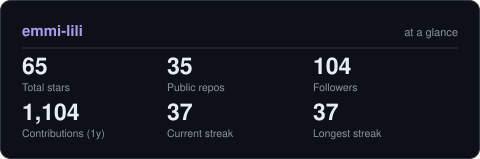
</picture>

<br>


</div>

---

<div align="center">

<sub>` Build with love· @emmcriptada `</sub>

</div>


---

## andriidrok1

<div align="center">


[andriidrok.com](https://andriidrok.com) &nbsp;·&nbsp;
[instagram](https://www.instagram.com/andrii_drok/) &nbsp;·&nbsp;
[linkedin](https://www.linkedin.com/in/andriidrok/) &nbsp;·&nbsp;
[email](mailto:clb@mirasvit.com)

</div>


> Andrii Drok. CS student at San Francisco State University, San Francisco Bay Area.<br>
> Small, sharp tools over big vague ideas.

I build fast, test on real users, and kill what doesn't work. Right now that's<br>
[autobroll](https://github.com/andriidrok1/autobroll) — an AI short-form video editor that runs in the browser. Also<br>
deep into markets: Pine Script indicators, backtesting, on-chain data.


<samp>python &nbsp; typescript &nbsp; javascript &nbsp; react &nbsp; node &nbsp; three.js &nbsp; fastapi &nbsp; postgres &nbsp; docker &nbsp; git &nbsp; linux</samp>


**[autobroll](https://github.com/andriidrok1/autobroll)** &nbsp;·&nbsp; <samp>typescript, remotion</samp><br>
AI short-form video editor in the browser. Auto captions with accents,<br>
drag-and-retime editing, b-roll placement: transcript in, rendered video out.

**[strategy-checker](https://github.com/andriidrok1/strategy-checker)** &nbsp;·&nbsp; <samp>python</samp><br>
Describe a trading strategy in plain English, get a real backtest with<br>
statistical validation. Exposes curve-fitting, not alpha.

**[compound](https://github.com/andriidrok1/compound)** &nbsp;·&nbsp; <samp>typescript, convex</samp><br>
Autonomous research agent for your second brain. Built solo at Nozomio<br>
Hackathon, EF SF.

**[andriidrok.com](https://andriidrok.com)** &nbsp;·&nbsp; <samp>three.js, webgl</samp><br>
Particle-morph portfolio: thousands of particles reshaping between scenes.


<div align="center">



</div>


Every graphic here is generated, not embedded from anyone else's server.<br>
`ascii.svg` is a photo pushed through a character ramp by<br>
[`scripts/make_portrait.py`](scripts/make_portrait.py); the stat graphics and<br>
these section headings are drawn by [a scheduled action](.github/workflows/stats.yml)<br>
straight from the GitHub GraphQL API, once a day, committing only what changed.

They animate with SMIL inside the SVG, because GitHub strips scripts from<br>
READMEs — and since nothing loads from a third party, nothing here can<br>
rate-limit or go dark. The headings are SVGs for the same reason: GitHub also<br>
strips CSS, so an image is the only way to put this page's own typeface on them.

The typeface is [JetBrains Mono](scripts/fonts), subset to just the characters<br>
each graphic draws and inlined as base64. That isn't only for looks: the<br>
portrait's grid assumes an advance width of exactly 0.600 em, and a viewer whose<br>
default monospace is narrower would otherwise see it squeezed.

Language totals cover public repositories only. `year.svg` uses the portrait's<br>
character ramp: `:` `+` `#` `@`, quiet to loud.

The full write-up, with the gotchas and how to reuse it, is in<br>
[how-this-page-is-built.md](how-this-page-is-built.md).


---

## Andrew6rant

<a href="https://github.com/Andrew6rant/Andrew6rant">
  <picture>
    <source media="(prefers-color-scheme: dark)" srcset="https://raw.githubusercontent.com/Andrew6rant/Andrew6rant/main/dark_mode.svg">
    
  </picture>
</a>


---

## AVIVASHISHTA29

<div align="center">

<!-- animated contribution graph: real data, boxes reveal cell by cell
     (regenerated daily by .github/workflows/update-profile-art.yml) -->

<h3><code>avi@github ~ $ ./contributions.sh</code></h3>


<br>
<br>

<!-- ascii portrait (left) + streak/numbers card (right). both svgs are
     840x880 so equal widths give equal heights.
     portrait: python scripts/prep_photo.py <dp.png> && python scripts/make_ascii_svg.py
     stats:    python scripts/render_stats_svg.py (same daily workflow) -->

<h3><code>avi@github ~ $ whoami</code></h3>

<table>
<tr>
<td valign="top"></td>
<td valign="top"></td>
</tr>
</table>

<br>
<br>

<h3><code>avi@github ~ $ ./links.sh</code></h3>

<p><b>Fullstack Developer · AI Builder · Instructor</b></p>

[](https://www.avivashishta.com)
[](https://linkedin.com/in/avivashishta)
[](https://www.instagram.com/avi_vashishta29)
[](https://avivashishta29.github.io)

<br>

</div>

