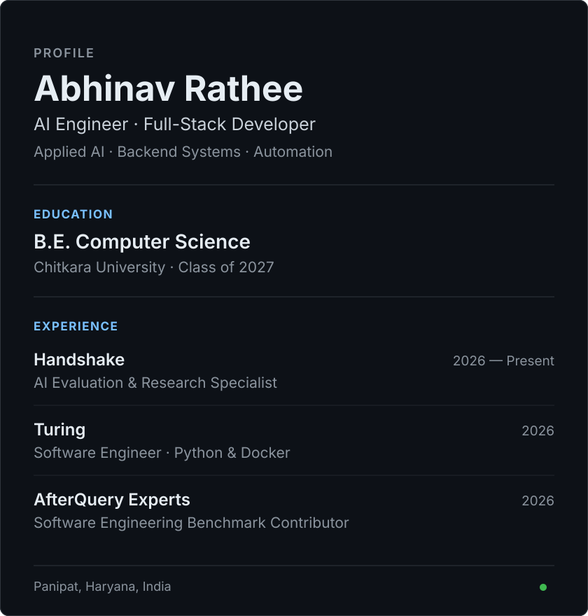

<h2>About Me</h2>

<table>
  <tr>
    <td valign="top"></td>
    <td valign="top"></td>
  </tr>
</table>

 

 

<h2>Connect With Me</h2>

<b>AI Engineer · Software Developer · Product Builder</b>

  
  
  
  
  
  
  

---

<h2>Technical Stack</h2>

Tools I use to build AI products, dependable services, and polished web apps.

<table align="center" width="100%">
  <tr>
    <td width="33.33%" valign="middle" align="center">
      <h3>💻 Languages</h3>
      

        
         
        
         
        
        
      

    </td>
    <td width="33.33%" valign="middle" align="center">
      <h3>🧠 AI &amp; Machine Learning</h3>
      

        
         
        
         
        
        
        
      

    </td>
    <td width="33.33%" valign="middle" align="center">
      <h3>⚙️ Backend &amp; APIs</h3>
      

        
         
        
         
        
        
      

    </td>
  </tr>
  <tr>
    <td width="33.33%" valign="middle" align="center">
      <h3>🎨 Frontend &amp; UI</h3>
      

        
         
        
        
      

    </td>
    <td width="33.33%" valign="middle" align="center">
      <h3>🗄️ Data Stores</h3>
      

        
         
        
        
      

    </td>
    <td width="33.33%" valign="middle" align="center">
      <h3>🚀 Systems &amp; Delivery</h3>
      

        
         
        
         
        
      

    </td>
  </tr>
</table>
