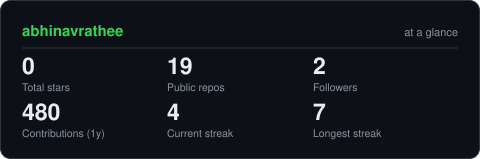
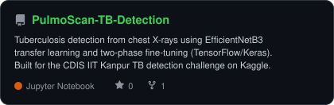
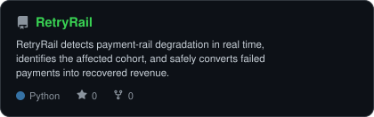
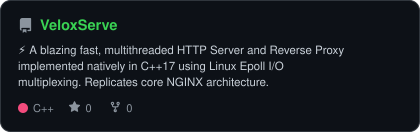
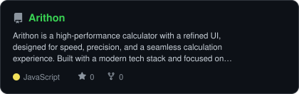

<h3><code>abhinav@github ~ $ whoami</code></h3>

<table>
  <tr>
    <td valign="top"></td>
    <td valign="top"></td>
  </tr>
</table>

  

<h3><code>abhinav@github ~ $ ./links.sh</code></h3>

<b>AI Engineer · Software Developer · Product Builder</b>

 

---

## `~/` GitHub signal

<table>
  <tr>
    <td align="center" valign="top">
      <picture>
        <source media="(prefers-color-scheme: dark)" srcset="./assets/extended/card-stats-dark.svg">
        <source media="(prefers-color-scheme: light)" srcset="./assets/extended/card-stats-light.svg">
        
      </picture>
    </td>
    <td align="center" valign="top">
      <picture>
        <source media="(prefers-color-scheme: dark)" srcset="./assets/extended/language-radar-dark.svg">
        <source media="(prefers-color-scheme: light)" srcset="./assets/extended/language-radar-light.svg">
        
      </picture>
    </td>
  </tr>
</table>

---

## `~/` selected work

<table>
  <tr>
    <td width="50%">
      <a href="https://github.com/abhinavrathee/PulmoScan-TB-Detection">
        <picture>
          <source media="(prefers-color-scheme: dark)" srcset="./assets/extended/card-PulmoScan-TB-Detection-dark.svg">
          <source media="(prefers-color-scheme: light)" srcset="./assets/extended/card-PulmoScan-TB-Detection-light.svg">
          
        </picture>
      </a>
    </td>
    <td width="50%">
      <a href="https://github.com/abhinavrathee/RetryRail">
        <picture>
          <source media="(prefers-color-scheme: dark)" srcset="./assets/extended/card-RetryRail-dark.svg">
          <source media="(prefers-color-scheme: light)" srcset="./assets/extended/card-RetryRail-light.svg">
          
        </picture>
      </a>
    </td>
  </tr>
  <tr>
    <td width="50%">
      <a href="https://github.com/abhinavrathee/VeloxServe">
        <picture>
          <source media="(prefers-color-scheme: dark)" srcset="./assets/extended/card-VeloxServe-dark.svg">
          <source media="(prefers-color-scheme: light)" srcset="./assets/extended/card-VeloxServe-light.svg">
          
        </picture>
      </a>
    </td>
    <td width="50%">
      <a href="https://github.com/abhinavrathee/Arithon">
        <picture>
          <source media="(prefers-color-scheme: dark)" srcset="./assets/extended/card-Arithon-dark.svg">
          <source media="(prefers-color-scheme: light)" srcset="./assets/extended/card-Arithon-light.svg">
          
        </picture>
      </a>
    </td>
  </tr>
</table>

Cards refresh automatically from the public GitHub API each day.

